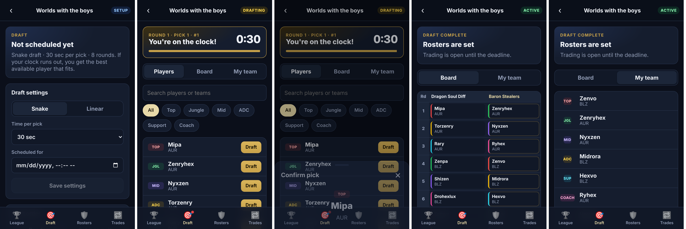

# Rift Fantasy

Fantasy-football-style leagues for League of Legends esports, built for
friends playing along with Worlds. Create a league, invite friends with a
code, run a live snake draft, and trade players.

| Folder | What it is |
|---|---|
| [`backend/`](backend/README.md) | FastAPI + SQLAlchemy 2.0 API on PostgreSQL: auth, leagues, drafts, rosters, trades |
| [`frontend/`](frontend/README.md) | Mobile-first React + Vite + TypeScript PWA that installs to a phone's home screen |

## Quick start

```bash
# API on :8000
cd backend
python -m venv .venv && . .venv/bin/activate
pip install -r requirements.txt
python -m app.create_tables --stubs
uvicorn app.main:app --reload

# App on :5173 (proxies /api to :8000)
cd frontend
npm install
npm run dev
```

Each folder's README covers configuration, tests, and deployment.



## License

LGPL-2.1, see [LICENSE](LICENSE).
